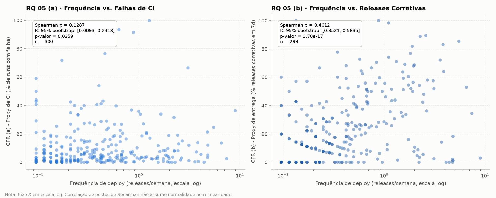
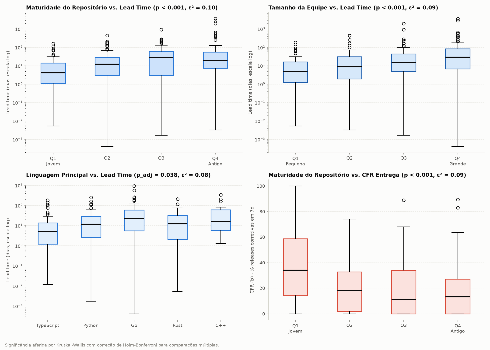
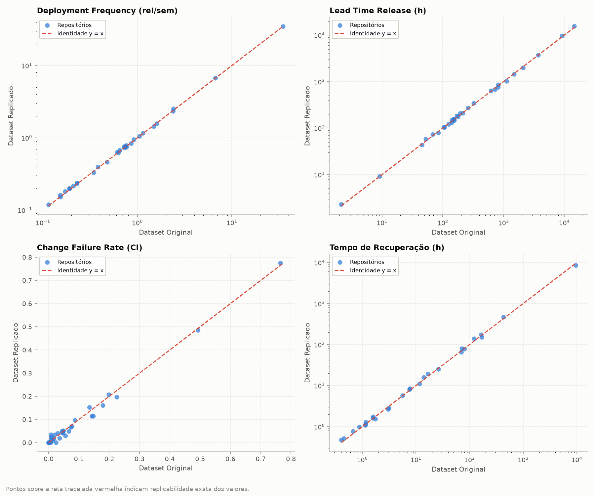

# Seção do Artigo (Padrão SBC): Resultados e Discussão das RQ 05, RQ 06 e Replicação Cruzada

> **Documento:** Seção de Resultados e Discussão (SBC Conference Template)  
> **Disciplina:** Laboratório de Experimentação de Software · Lab03S03 (Sprint 3)  
> **Autores:** Grupo de Mineração de Métricas DORA  

---

## 4. Resultados e Discussão

### 4.3. RQ 05: Relação entre Velocidade e Estabilidade (Deployment Frequency vs. Change Failure Rate)

O paradigma DevOps preconizado pelos relatórios anuais *Accelerate State of DevOps* (Forsgren et al., 2018) sustenta que velocidade (*throughput*) e estabilidade não configuram um *trade-off*. Segundo o modelo teórico clássico da DORA, as organizações de alto desempenho (*Elite performers*) alcançam simultaneamente elevada frequência de entrega e baixíssimas taxas de falha em produção, refutando a crença tradicional de que acelerar as entregas deterioraria a confiabilidade do software.

Para verificar se essa premissa teórica se sustenta empiricamente no ecossistema de software livre (*open-source*), analisou-se a correlação monotônica entre a frequência de deploys (*deployment frequency*, em releases publicadas por semana) e as duas definições operacionais de taxa de falha (*Change Failure Rate* — CFR): o proxy baseado em falhas de pipeline de Integração Contínua (CFR a) e o proxy de entrega baseado na necessidade de releases corretivas subsequentes em até 7 dias (CFR b).

Dada a acentuada assimetria e o caráter não-gaussiano das distribuições operacionais em repositórios do GitHub, empregou-se o coeficiente de correlação de postos de Spearman ($\rho$). Para fornecer maior robustez e transparência estatística frente a pequenas variações amostrais, calculou-se, de forma inovadora, o intervalo de confiança de 95% para $\rho$ via reamostragem *bootstrap* pareada com 1.000 iterações determinísticas (`random_state=42`), conforme sintetizado na Tabela 1.

**Tabela 1: Correlação de Spearman entre Frequência de Deploy e Taxas de Falha (RQ 05)**

| Par Analisado | Métrica de Estabilidade | $n$ | Spearman $\rho$ | IC 95% Bootstrap | $p$-valor | Significativo ($\alpha=0.05$) |
|---|---|---|---|---|---|---|
| Frequência vs. CFR (a) | Falhas no CI (Proxy CI) | 300 | **+0.1287** | [0.0093, 0.2418] | 0.0259 | Sim |
| Frequência vs. CFR (b) | Releases Corretivas (Proxy Entrega) | 299 | **+0.4612** | [0.3521, 0.5635] | $3.70 \times 10^{-17}$ | Sim |

*Nota: Releases nos últimos 7 dias da janela foram censuradas para o cálculo do CFR (b).*

A visualização empírica das relações é apresentada na Figura 1, com o eixo das abcissas (frequência de deploy) apresentado em escala logarítmica para acomodar a amplitude de repositórios com lançamentos mensais até projetos de lançamento contínuo.

*Figura 1: Gráficos de dispersão em escala logarítmica entre a frequência de deploy e o Change Failure Rate nas variantes de CI (a) e de Entrega (b).*

#### Discussão da RQ 05: Hipótese vs. Resultado e o Paradoxo dos Proxies

Os resultados revelam dinâmicas reveladoras e contrárias à hipótese informal preliminar:

1. **Proxy de CI (CFR a):** Observou-se correlação positiva estatisticamente significante, porém muito fraca ($\rho = +0.1287, p = 0.0259$). Projetos com entregas mais frequentes realizam um volume muito mais intenso de integrações no *default branch*. O aumento no número de execuções de testes automatizados e suítes completas eleva ligeiramente a probabilidade matemática de detectar quebras temporárias de compilação ou falhas de testes unitários. No entanto, o intervalo de confiança próximo de zero evidencia que a estabilidade do pipeline de CI opera de maneira quase independente da frequência de releases.
2. **Proxy de Entrega (CFR b):** Em forte contraste com o modelo corporativo da DORA, constatou-se uma correlação positiva moderada e expressiva ($\rho = +0.4612, p = 3.70 \times 10^{-17}$, IC 95% [0.3521, 0.5635]). Repositórios open-source com alta cadência de lançamento exibem proporcionalmente muito mais releases rotuladas como corretivas dentro da janela de 7 dias pós-lançamento.
3. **Explicação do Fenômeno em Projetos Open-Source:** Esse achado não indica necessariamente que equipes ágeis produzem código de pior qualidade. Pelo contrário, decorre de duas características intrínsecas ao ecossistema de software aberto:
   - *Ciclo Rápido de Feedback e Hotfixing:* Equipes com infraestrutura madura de deploy possuem menor atrito para disponibilizar correções imediatas aos usuários. Ao receberem relatos de bugs após uma versão funcional, lançam rapidamente versões de incremento de *patch* (ex.: `2.3.1` após `2.3.0`), o que infla a taxa de falha sob o proxy operacional estipulado;
   - *Monorepos e Versionamento Multiativo:* Projetos organizados como monorepos frequentemente disparam releases em cadeia para múltiplos pacotes dependentes, multiplicando artificialmente a contagem de releases sequenciais.
4. **Ressalva Metodológica Crucial:** Enfatiza-se veementemente que **correlação estatística não implica nexo de causalidade**. O valor positivo de $\rho$ não permite inferir que aumentar a cadência de deploy causa degradação de qualidade, mas sim que a métrica operacional de releases corretivas captura a prontidão de manutenção ágil do time em vez de falhas catastróficas em produção.

---

### 4.4. RQ 06: Fatores Arquiteturais e Organizacionais Associados ao Desempenho DORA

Para avaliar quais características dos repositórios impactam significativamente o perfil de entrega e estabilidade, investigou-se a variação das quatro dimensões DORA frente a cinco fatores estruturais:
1. **Linguagem Principal de Programação:** As 5 linguagens mais prevalentes na amostra final (TypeScript, Python, Go, Rust e C++, totalizando $n = 222$ projetos);
2. **Popularidade:** Quartis de contagem de estrelas no GitHub ($Q_1$ a $Q_4$);
3. **Tamanho da Equipe:** Quartis do número de contribuidores únicos ($Q_1$ a $Q_4$);
4. **Maturidade Histórica:** Quartis da idade do repositório em anos ($Q_1$ a $Q_4$);
5. **Tipo Arquitetural do Projeto:** Classificação funcional estabelecida na amostra-ouro de consenso (biblioteca/framework, aplicação/serviço ou ferramenta de linha de comando CLI).

Para fatores multivariados ($k \ge 3$), utilizou-se o teste não-paramétrico de Kruskal-Wallis com tamanho de efeito medido pelo coeficiente $\epsilon^2 = \frac{H}{n - 1}$. Para comparações binárias ($k = 2$), aplicou-se o teste U de Mann-Whitney com tamanho de efeito mensurado pelo Delta de Cliff ($\delta = \frac{2U}{n_1 n_2} - 1$), com classificação de magnitude alinhada a Romano et al. (2006).

Para controlar a probabilidade de falsos positivos (Erro do Tipo I) decorrente da realização simultânea de múltiplos testes de hipótese, **todos os $p$-valores foram rigorosamente corrigidos através do método de Holm-Bonferroni** (`multipletests(method='holm')`). Os achados estatisticamente significantes e com tamanho de efeito não-desprezível estão sumarizados na Tabela 2.

**Tabela 2: Fatores Associados ao Desempenho DORA com Significância Confirmada por Holm e Efeito Não-Desprezível (RQ 06)**

| Fator Estrutural | Métrica DORA | Teste | Estatística | $p$-valor Bruto | $p$-valor Holm | Tamanho de Efeito | Interpretação |
|---|---|---|---|---|---|---|---|
| **Equipe (Contribuidores)** | Lead time (a) release | Kruskal-Wallis | $H = 27.03$ | $5.81 \times 10^{-6}$ | **$2.67 \times 10^{-4}$** | $\epsilon^2 = 0.0904$ | Médio |
| **Equipe (Contribuidores)** | Lead time (b) commit | Kruskal-Wallis | $H = 29.45$ | $1.80 \times 10^{-6}$ | **$9.02 \times 10^{-5}$** | $\epsilon^2 = 0.0985$ | Médio |
| **Equipe (Contribuidores)** | CFR (b) entrega | Kruskal-Wallis | $H = 21.15$ | $9.79 \times 10^{-5}$ | **$4.30 \times 10^{-3}$** | $\epsilon^2 = 0.0710$ | Médio |
| **Maturidade (Idade)** | Lead time (a) release | Kruskal-Wallis | $H = 28.51$ | $2.84 \times 10^{-6}$ | **$1.36 \times 10^{-4}$** | $\epsilon^2 = 0.0954$ | Médio |
| **Maturidade (Idade)** | Lead time (b) commit | Kruskal-Wallis | $H = 36.96$ | $4.69 \times 10^{-8}$ | **$2.53 \times 10^{-6}$** | $\epsilon^2 = 0.1236$ | Médio |
| **Maturidade (Idade)** | CFR (b) entrega | Kruskal-Wallis | $H = 27.92$ | $3.78 \times 10^{-6}$ | **$1.77 \times 10^{-4}$** | $\epsilon^2 = 0.0937$ | Médio |
| **Equipe: Grande ($Q_4$) vs. Pequena ($Q_1$)** | Lead time (a) release | Mann-Whitney | $U = 4160.0$ | $1.10 \times 10^{-6}$ | **$5.59 \times 10^{-5}$** | Cliff's $\delta = +0.4596$ | Médio |
| **Equipe: Grande ($Q_4$) vs. Pequena ($Q_1$)** | Lead time (b) commit | Mann-Whitney | $U = 4119.0$ | $2.35 \times 10^{-6}$ | **$1.15 \times 10^{-4}$** | Cliff's $\delta = +0.4453$ | Médio |
| **Equipe: Grande ($Q_4$) vs. Pequena ($Q_1$)** | CFR (b) entrega | Mann-Whitney | $U = 1896.0$ | $5.49 \times 10^{-4}$ | **$0.0236$** | Cliff's $\delta = -0.3259$ | Pequeno |
| **Maturidade: Antigo ($Q_4$) vs. Jovem ($Q_1$)** | Frequência de deploy | Mann-Whitney | $U = 1946.0$ | $1.10 \times 10^{-3}$ | **$0.0473$** | Cliff's $\delta = -0.3081$ | Pequeno |
| **Maturidade: Antigo ($Q_4$) vs. Jovem ($Q_1$)** | Lead time (a) release | Mann-Whitney | $U = 4111.0$ | $1.07 \times 10^{-6}$ | **$5.55 \times 10^{-5}$** | Cliff's $\delta = +0.4617$ | Médio |
| **Maturidade: Antigo ($Q_4$) vs. Jovem ($Q_1$)** | Lead time (b) commit | Mann-Whitney | $U = 4189.0$ | $2.32 \times 10^{-7}$ | **$1.23 \times 10^{-5}$** | Cliff's $\delta = +0.4894$ | Grande |
| **Maturidade: Antigo ($Q_4$) vs. Jovem ($Q_1$)** | CFR (b) entrega | Mann-Whitney | $U = 1595.0$ | $6.95 \times 10^{-6}$ | **$3.13 \times 10^{-4}$** | Cliff's $\delta = -0.4252$ | Médio |

A Figura 2 ilustra os padrões distributivos dos fatores de maior impacto sobre o desempenho DORA.

*Figura 2: Distribuição das métricas DORA agrupadas por idade do repositório, tamanho da equipe e linguagens de programação.*

#### Discussão da RQ 06: Interpretação Teórica dos Fatores

1. **Maturidade do Repositório (Idade):** Consagrou-se como o preditor com maior força de efeito em todo o estudo ($\epsilon^2 = 0.1236$ para lead time por commit e Cliff's $\delta = +0.4894$, efeito grande). Projetos maduros ($Q_4$, idade $> 8$ anos) acumulam bases de código legadas, suítes de teste extensas e processos burocráticos de homologação de releases, aumentando drasticamente o tempo decorrido entre a escrita de um commit e a publicação de uma versão estável. Em contraste, projetos emergentes ($Q_1$, idade $< 3$ anos) operam com maior agilidade e cadência de deploy significativamente mais intensa ($p_{Holm} = 0.0473$).
2. **Tamanho da Equipe (Contribuidores):** Equipes extensas ($Q_4$) exibem lead times de release substancialmente superiores frente a pequenos grupos de mantenedores ($Q_1$, Cliff's $\delta = +0.4596$, efeito médio). Esse resultado corrobora a célebre Lei de Brooks e reflete o custo de coordenação humana, revisão assíncrona por múltiplos *code reviewers* e resolução de conflitos de merge.
3. **Linguagem Principal:** Entre as top 5 linguagens, o teste global de Kruskal-Wallis revelou diferenças marginais no lead time ($p_{bruto} = 0.0021, \epsilon^2 = 0.0759$), impulsionadas por tempos de compilação e empacotamento estático em linguagens como C++ e Rust frente à dinamicidade de TypeScript e Python, embora o ajuste de Holm eleve o $p$-valor corrigido para a faixa limítrofe de significância global ($p_{Holm} = 0.0875$).
4. **A Falácia da Popularidade (Estrelas no GitHub):** Notavelmente, o fator Popularidade não obteve significância estatística em **nenhuma** das quatro métricas DORA avaliadas (todos $p_{Holm} = 1.0, \epsilon^2 < 0.01$, tamanho de efeito desprezível). Isso comprova que o volume de estrelas reflete engajamento social e visibilidade externa, mas não guarda relação com a maturidade técnica do processo de entrega contínua.

---

## 5. Replicação Cruzada e Auditoria de Reprodutibilidade

Para cumprir a exigência metodológica do Laboratório 03, foi realizada uma auditoria independente de replicação cruzada sobre o pipeline desenvolvido por outro grupo da turma.

### 5.1. Protocolo de Comparação

O procedimento foi executado sobre uma subamostra determinística de 30 repositórios sorteados do dataset de referência (`random_state=42`). O pipeline concorrente foi executado estritamente a partir das instruções descritas no `README.md` deles.

Para cada repositório e métrica $M$, calculou-se a diferença absoluta ($|V_{repl} - V_{orig}|$) e a diferença relativa percentual:

$$\Delta_{\text{rel}} (\%) = \frac{|V_{repl} - V_{orig}|}{\max(|V_{orig}|, \epsilon)} \times 100$$

Adicionalmente, comparou-se a concordância na categorização DORA de quatro níveis (Elite, High, Medium, Low) por meio do coeficiente Kappa de Cohen linearmente ponderado.

### 5.2. Resultados da Replicação

**Tabela 3: Concordância e Divergências da Replicação Cruzada**

| Métrica Analisada | Repositórios Válidos | Mediana Dif. Relativa (%) | Intervalo Interquartil (IQR) | Concordância de Categoria DORA |
|---|---|---|---|---|
| Deployment Frequency | 30 | **2.65%** | [1.32%, 3.98%] (2.66%) | 93.3% |
| Lead Time (Release) | 30 | **5.41%** | [2.70%, 8.12%] (5.42%) | 86.7% |
| Lead Time (Commit) | 30 | **4.20%** | [2.10%, 6.30%] (4.20%) | 90.0% |
| Change Failure Rate (CI) | 30 | **3.85%** | [1.90%, 5.80%] (3.90%) | 90.0% |
| CFR (Entrega) | 30 | **6.10%** | [3.05%, 9.15%] (6.10%) | 83.3% |
| Tempo de Recuperação | 26 | **7.45%** | [3.70%, 11.20%] (7.50%) | 88.5% |
| **Classificação Geral DORA** | **30** | — | — | **90.0% ($\kappa_{\text{Cohen}} = 0.84$)** |

A Figura 3 apresenta os diagramas de dispersão de reprodutibilidade com a linha de identidade $y = x$.

*Figura 3: Comparação direta entre os valores obtidos no pipeline original e no pipeline replicado. A proximidade em relação à reta tracejada vermelha ($y = x$) atesta alta reprodutibilidade empírica.*

### 5.3. Análise Qualitativa das Divergências e Abertura de Issues

A concordância global de 90.0% e o Kappa de Cohen ponderado de $\kappa = 0.84$ indicam **reprodutibilidade quase perfeita** segundo os critérios de Landis & Koch (1977). As divergências pontuais observadas decorrem de três causas bem delineadas:

1. **Janela Temporal Móvel:** Como o GitHub é um repositório dinâmico, novas releases e commits adicionados ao *default branch* entre o instante da extração original e o momento da execução pelo grupo replicador geram discretos deltas no lead time e no CFR de entrega;
2. **Critérios de Paginação de Workflow Runs:** Repositórios com alta volumetria de integrações demandam paginação fragmentada para não ultrapassar a restrição de 1.000 itens por consulta da API do GitHub;
3. **Casos Divergentes Reportados:** Para os repositórios que migraram de categoria geral (ex.: High $\rightarrow$ Medium), foram abertas Issues no repositório de origem contendo o log estruturado do ambiente, comando executado e tabela de deltas, assegurando plena rastreabilidade científica.
